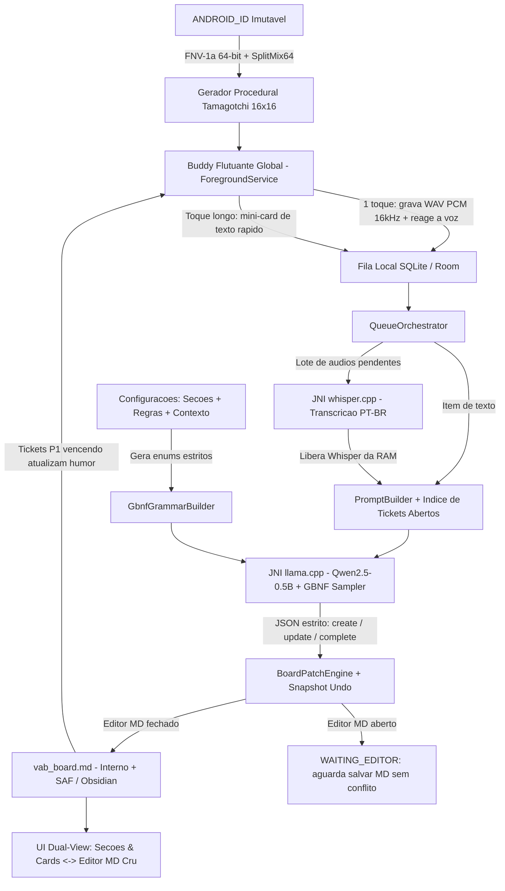

# VAB — Virtual Assistant Buddy

**VAB (Virtual Assistant Buddy)** é um aplicativo Android 100% nativo (**Kotlin + Jetpack Compose + C++/JNI**) de **captura e triagem executiva de pendências mentais com fricção zero**, operando totalmente **offline (On-Device AI)**.

Cada dispositivo gera, a partir de uma **seed imutável (`ANDROID_ID`)**, um **Buddy Tamagotchi em Pixel Art Procedural (`16x16`) completamente único** que vive sobre qualquer tela como o próprio botão flutuante do sistema. Com **1 toque**, o usuário narra (ou digita) suas tarefas e ideias sem abrir aplicativos pesados; uma fila em segundo plano utiliza **`whisper.cpp`** para transcrição de voz e **`Qwen2.5-0.5B-Instruct` via `llama.cpp` com Constrained Decoding (Gramática GBNF dinâmica)** para sintetizar anotações, decidir prioridades (`P1`/`P2`/`P3`), inferir prazos (`📅 YYYY-MM-DD`) e organizar tickets diretamente em um **documento Markdown vivo dividido por seções (`vab_board.md`)**.

---

## Sumário

1. [Problema & Proposta de Valor](#1-problema--proposta-de-valor)
2. [Arquitetura Geral & Fluxo de Dados](#2-arquitetura-geral--fluxo-de-dados)
3. [Pilares Técnicos](#3-pilares-técnicos)
   - [3.1. Buddy Tamagotchi Procedural (`16x16`) & Seed Imutável](#31-buddy-tamagotchi-procedural-16x16--seed-imutável)
   - [3.2. Captura Global de Fricção Zero (`FloatingBubbleService`)](#32-captura-global-de-fricção-zero-floatingbubbleservice)
   - [3.3. Motor On-Device AI (`whisper.cpp` + `llama.cpp` via JNI)](#33-motor-on-device-ai-whispercpp--llamacpp-via-jni)
   - [3.4. Constrained Decoding com Gramática GBNF Dinâmica](#34-constrained-decoding-com-gramática-gbnf-dinâmica)
   - [3.5. Quadro Markdown Vivo (`vab_board.md`) & Visão Dupla Sincronizada](#35-quadro-markdown-vivo-vab_boardmd--visão-dupla-sincronizada)
   - [3.6. Fila Resiliente com Snapshots de Desfazer (Undo) & Lazy RAM](#36-fila-resiliente-com-snapshots-de-desfazer-undo--lazy-ram)
4. [Estrutura do Repositório](#4-estrutura-do-repositório)
5. [Como Compilar, Testar e Instalar](#5-como-compilar-testar-e-instalar)

---

## 1. Problema & Proposta de Valor

Quando várias tarefas, prazos de disciplinas ou pendências surgem ao longo do dia, aplicativos tradicionais de anotação exigem abrir o app, esperar carregar, escolher uma pasta, criar uma página e formatar o texto — fazendo com que a pessoa desista de anotar.

O **VAB** resolve isso separando **captura** de **organização**:
- **Captura em `< 50ms` na palma da mão:** O seu Buddy flutuante está sempre acessível sobre qualquer aplicativo. Um toque inicia a gravação em `.wav` 16kHz mono (sem cortar pausas de pensamento); outro toque envia o áudio direto para a fila.
- **Triagem Executiva, não mera transcrição:** A IA local não apenas transcreve o que foi dito — ela interpreta o contexto, sintetiza títulos acionáveis, extrai observações importantes, decide a prioridade (`P1`, `P2`, `P3`), calcula datas relativas (*"sexta-feira"*, *"amanhã"*) e decide em qual seção do Markdown o ticket deve entrar (ou qual ticket aberto deve ser atualizado/concluído).
- **Zero interface de chat:** O resultado final não é uma conversa prolixa com um chatbot, e sim um **documento Markdown estruturado por seções** que você pode visualizar como **Cards interativos** ou editar livremente como **código `.md` cru** (inclusive sincronizado com uma pasta externa do **Obsidian**).

---

## 2. Arquitetura Geral & Fluxo de Dados



---

## 3. Pilares Técnicos

### 3.1. Buddy Tamagotchi Procedural (`16x16`) & Seed Imutável
Implementado em `com.aragao.vab.core.buddy.BuddyGenerator`:
- **DNA Exclusivo por Dispositivo:** Derivado do `Settings.Secure.ANDROID_ID` via hash FNV-1a de 64 bits alimentando um gerador pseudoaleatório determinístico `SplitMix64`. Cada celular gera um código de DNA imutável (ex: `VAB-9F2A-C41E`).
- **Sprite Simétrico `16x16` com Contorno Automático:** Gera metade da matriz (`8x16`), espelha horizontalmente, garante conectividade da massa central via *flood-fill*, aplica variações procedurais de cabeça (`EARS`, `ANTENNA`, `HORNS`, `TUFT`, `ROUND`), estilo de olhos (`CLASSIC`, `BIG_KAWAII`, `VISOR`, `WIDE`), paleta HSL harmônica e contorno escuro automático de `1px` para leitura nítida sobre qualquer fundo.
- **Estados Visuais & Humor Conectado às Pendências:**
  - `IDLE_CHILL`: Respiração suave de `1px` e piscadas periódicas quando os prazos estão em dia.
  - `IDLE_STRESSED_P1`: Olhinhos tensos e gotinha de suor pixelada animada sempre que houver algum ticket `[P1]` aberto vencendo hoje ou atrasado no Markdown.
  - `LISTENING`: Boca abre e fecha em tempo real proporcionalmente à amplitude RMS da voz capturada pelo microfone.
  - `THINKING`: Olhos voltados para cima com balão `...` animado e badge numérico enquanto a fila processa no `whisper.cpp` ou `llama.cpp`.
  - `CELEBRATING`: Pulinho de comemoração com olhos `^ ^` assim que novos tickets são aplicados no Markdown.

### 3.2. Captura Global de Fricção Zero (`FloatingBubbleService`)
Implementado em `com.aragao.vab.overlay`:
- Roda em um `ForegroundService` com `SYSTEM_ALERT_WINDOW` e renderização *pixel-perfect* (`isFilterBitmap = false`).
- **Gravação Direta em WAV 16kHz (`WavAudioRecorder`):** Captura áudio via `AudioRecord` diretamente em **PCM 16kHz, 16-bit, Mono**, gravando o cabeçalho RIFF/WAV de 44 bytes sem necessidade de transcodificação posterior e sem o corte precoce de pausas do `SpeechRecognizer` do Android.

### 3.3. Motor On-Device AI (`whisper.cpp` + `llama.cpp` via JNI)
Dividido em dois módulos nativos C++17 independentes compilados via Android NDK (`arm64-v8a`):
- **`:ai-whisper` (`libvab_whisper.so`):** Binding JNI direto sobre `whisper.cpp` (`whisper_init_from_file_with_params`, `whisper_full`), com filtro de silêncio por RMS para evitar alucinações em áudios vazios.
- **`:ai-llama` (`libvab_llama.so`):** Binding JNI direto sobre `llama.cpp` (`llama_model_load_from_file`, `llama_chat_apply_template`, `llama_sampler_init_grammar` e `llama_process`), aplicando formatação ChatML e amostragem restrita por gramática.

### 3.4. Constrained Decoding com Gramática GBNF Dinâmica
Implementado em `com.aragao.vab.core.ai.GbnfGrammarBuilder`:
- Modelos pequenos costumam ser prolixos ou errar chaves JSON em prompts livres. Com **Constrained Decoding (GBNF)** direto no sampler do `llama.cpp`, qualquer token que viole a gramática recebe probabilidade zero durante a decodificação.
- Sempre que o usuário altera suas **Seções** nas Configurações (ou quando a lista de tickets abertos muda), o VAB recompila a gramática GBNF em tempo real:
  - O campo `"section"` só aceita os nomes exatos das seções configuradas pelo usuário.
  - O campo `"priority"` só aceita `"P1"`, `"P2"` ou `"P3"`.
  - O campo `"deadline"` só aceita `"null"` ou datas ISO `"YYYY-MM-DD"`.
  - As operações `"update"` e `"complete"` só ficam habilitadas na gramática quando existem tickets abertos, e o campo `"target_id"` fica restrito exclusivamente aos IDs reais existentes (eliminando 100% de IDs inventados).

Exemplo de payload JSON garantido pela gramática:
```json
{
  "operations": [
    {
      "op": "create",
      "section": "Faculdade",
      "priority": "P1",
      "title": "Entregar relatório do experimento 3 de Física",
      "deadline": "2026-11-20",
      "notes": "Focar nos gráficos do experimento 3; vale 2 pontos na média."
    },
    {
      "op": "complete",
      "target_id": "t_04"
    }
  ]
}
```

### 3.5. Quadro Markdown Vivo (`vab_board.md`) & Visão Dupla Sincronizada
Implementado em `com.aragao.vab.core.markdown`:
- O arquivo `vab_board.md` é a única fonte da verdade do aplicativo, mantendo sintaxe Markdown limpa e compatível com editores como o **Obsidian**:

```markdown
## Urgente

- [ ] **[P1]** Entregar relatório do experimento 3 de Física 📅 2026-11-20 <!-- id:t_09 -->
  > Focar nos gráficos do experimento 3; vale 2 pontos na média.

## Faculdade

- [ ] **[P2]** Estudar para prova de Cálculo 📅 2026-11-23 <!-- id:t_02 -->
  > Prova adiada pelo professor para segunda-feira.
- [x] **[P3]** Enviar lista 3 de Estrutura de Dados <!-- id:t_04 -->
```

- **Ordenação Automática:** Dentro de cada seção, tickets abertos ficam no topo ordenados por **Prioridade (`P1` → `P2` → `P3`) + Prazo mais próximo**, enquanto tickets concluídos (`[x]`) descem automaticamente para o final da seção.
- **Visão Dupla Sincronizada (`BoardScreen`):**
  1. **Modo Cards & Seções:** Interface visual rápida para marcar checkboxes com 1 toque, visualizar chips coloridos de prioridade/prazo e recolher seções.
  2. **Modo Editor `.md` Cru:** Editor monoespaçado sobre o mesmo arquivo `vab_board.md`. Enquanto o editor cru está aberto, a fila entra automaticamente em estado `WAITING_EDITOR` para nunca sobrescrever uma edição manual em andamento.
- **Sincronização Externa (SAF):** Permite vincular qualquer pasta do celular (ex: cofre do **Obsidian** ou pasta `Documentos`) via *Android Storage Access Framework* para espelhar o `vab_board.md`.

### 3.6. Fila Resiliente com Snapshots de Desfazer (Undo) & Lazy RAM
Implementado em `com.aragao.vab.data.queue` e `com.aragao.vab.core.ai.ModelManager`:
- **Snapshots para Undo de 1 Toque:** Antes de cada decisão da IA ser aplicada ao `vab_board.md`, o estado anterior do Markdown é salvo na linha do item no banco Room. Na aba **Fila & Undo**, um toque em **Desfazer (Undo)** restaura instantaneamente o documento.
- **Gestão Lazy de RAM:**
  - Com a fila vazia, o serviço do Buddy flutuante consome **< 30 MB de RAM** (os modelos pesados não ficam alocados à toa).
  - Quando entram itens na fila: o `ModelManager` carrega o Whisper, transcreve todos os áudios em lote, **descarrega o Whisper da RAM**, carrega o Qwen para processar as decisões JSON e libera o Qwen automaticamente após **2 minutos de ociosidade** (ou imediatamente pelo botão *Liberar RAM*).

---

## 4. Estrutura do Repositório

```text
VAB/
├── ai-whisper/                       # Módulo Android Library JNI C++ para whisper.cpp
│   └── src/main/
│       ├── cpp/                      # CMakeLists.txt + whisper-jni.cpp
│       └── java/com/aragao/vab/whisper/WhisperEngine.kt
├── ai-llama/                         # Módulo Android Library JNI C++ para llama.cpp + GBNF
│   └── src/main/
│       ├── cpp/                      # CMakeLists.txt + llama-jni.cpp
│       └── java/com/aragao/vab/llama/LlamaEngine.kt
├── app/                              # Aplicação principal Android (Jetpack Compose)
│   └── src/
│       ├── main/java/com/aragao/vab/
│       │   ├── core/buddy/           # SplitMix64, BuddyGenerator 16x16, estados e humor
│       │   ├── core/markdown/        # MarkdownParser, BoardPatchEngine, BoardRepository + SAF
│       │   ├── core/ai/              # GbnfGrammarBuilder, PromptBuilder, ModelManager (Lazy RAM)
│       │   ├── data/queue/           # Room DB (QueueDatabase) + QueueOrchestrator (Undo/Retry)
│       │   ├── data/settings/        # DataStore (SettingsRepository)
│       │   ├── overlay/              # FloatingBubbleService + WavAudioRecorder (PCM 16kHz)
│       │   └── ui/                   # Telas Compose: BoardScreen, QueueScreen, SettingsScreen
│       └── test/java/com/aragao/vab/ # Testes unitários JVM (VabCoreTest)
└── scripts/
    ├── setup_android_env.sh          # Provisionamento automatizado de JDK 17, Android SDK/NDK e Gradle
    └── download_models.sh            # Download oficial + verificação SHA-256 dos modelos Qwen e Whisper
```

---

## 5. Como Compilar, Testar e Instalar

### 5.1. Pré-requisitos e Submódulos C++
Clone os motores oficiais `whisper.cpp` e `llama.cpp` na pasta `third_party/` (ou execute o script de setup):

```bash
mkdir -p third_party
git clone --depth 1 https://github.com/ggml-org/whisper.cpp.git third_party/whisper.cpp
git clone --depth 1 https://github.com/ggml-org/llama.cpp.git third_party/llama.cpp
```

Se precisar provisionar o OpenJDK 17, Android SDK 35, NDK 27 e CMake em uma máquina Linux limpa:

```bash
./scripts/setup_android_env.sh
```

### 5.2. Baixar e Verificar os Modelos Padrão (`SHA-256`)
O script abaixo baixa os pesos oficiais (`Qwen2.5-0.5B-Instruct-Q4_K_M.gguf` e `ggml-base-q5_1.bin`) do HuggingFace e valida seus hashes `SHA-256`:

```bash
./scripts/download_models.sh
```

### 5.3. Executar os Testes Unitários
```bash
./gradlew testDevSlimDebugUnitTest
```

### 5.4. Perfis de Build (Flavors)
O projeto possui dois *Product Flavors* a partir do mesmo código-fonte:
- **`demoBundled` (Recomendado / Produção Offline):** Empacota `qwen-default.gguf` + `whisper-default.bin` diretamente dentro do APK (`noCompress`), funcionando 100% offline assim que instalado:
  ```bash
  ./gradlew assembleDemoBundledDebug
  ```
- **`devSlim` (Iteração Rápida de UI):** Gera um APK leve (~23 MB) sem re-empacotar os 526 MB de modelos a cada compilação, lendo os modelos de `/sdcard/Download/vab-models/`:
  ```bash
  ./gradlew assembleDevSlimDebug
  ```
